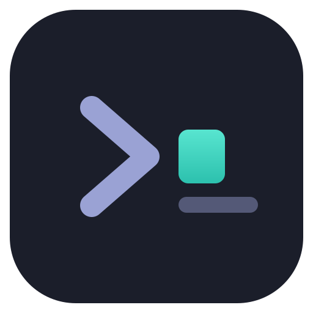
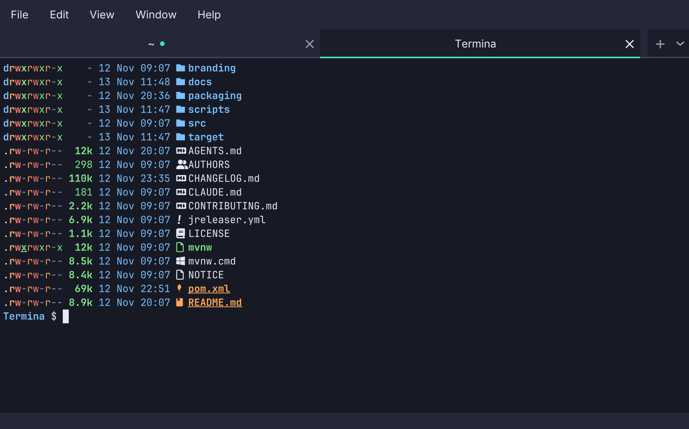

<p align="center">
  
</p>

<h1 align="center">Termina</h1>

<p align="center">
  <a href="https://github.com/adriandeleon/Termina/actions/workflows/ci.yml"></a>
  <a href="https://github.com/adriandeleon/Termina/releases/latest"></a>
  <a href="LICENSE"></a>
  
  
  
  <a href="https://termina-project.dev/docs/pauta/"></a>
</p>

<p align="center">
  <picture>
    <source media="(prefers-color-scheme: light)" srcset="docs/screenshot-light.png">
    
  </picture>
</p>

A cross-platform terminal emulator built on JavaFX. Runs a real shell on a real pseudo-terminal and
renders the emulated screen to a canvas.

🌐 **[termina-project.dev](https://termina-project.dev)** — [features](https://termina-project.dev/features/),
[user docs](https://termina-project.dev/docs/), [keybindings](https://termina-project.dev/keybindings/),
[news](https://termina-project.dev/news/) and the [blog](https://termina-project.dev/blog/).
The site's source is [adriandeleon/termina-website](https://github.com/adriandeleon/termina-website).

Built to [Pauta (the adl desktop apps guidelines)](https://pauta-project.dev/), edition [6.1.0](https://pauta-project.dev/6.1.0/), [Pauta conformance: Core](https://termina-project.dev/docs/pauta/).

Status: **early**. It is used on macOS and Linux. Windows is built, packaged and tested in CI on
every commit, but nobody has opened a window there yet.

## Highlights

Each link opens the feature's page on the website; the [user docs](https://termina-project.dev/docs/)
have the full reference.

- **A real shell.** Your own shell on a real pseudo-terminal — `forkpty` on macOS and Linux, ConPTY
  on Windows — started as a login shell, so `PATH` is what your profile makes it.
  ([real shell](https://termina-project.dev/features/real-shell/))
- **xterm compatibility from JetBrains' JediTerm**, so vim, htop and less behave: every mouse wire
  format, application cursor keys, the kitty keyboard protocol.
  ([compatibility](https://termina-project.dev/features/compatibility/))
- **Tabs, split panes and windows.** Tabs that can be dragged, renamed, pinned and reopened; panes
  side by side or stacked, moved between tabs by dragging.
  ([tabs](https://termina-project.dev/features/tabs/),
  [split panes](https://termina-project.dev/features/split-panes/))
- **A command palette and keys you can move.** Every command, open tab, shell profile, theme and
  setting by typing part of its name; every shortcut rebindable, and none that takes a key the shell
  needs. ([palette](https://termina-project.dev/features/command-palette/),
  [shortcuts](https://termina-project.dev/features/keyboard-shortcuts/))
- **Shell integration.** Prompts marked with OSC 133 become jumps and selectable output; a program
  can post a desktop notification when it finishes.
  ([shell integration](https://termina-project.dev/features/shell-integration/),
  [notifications](https://termina-project.dev/features/notifications/))
- **Links and paths you can click**, opened in the browser or in your editor at the line a compiler
  named. ([links](https://termina-project.dev/features/links/))
- **Every shell the machine has**, found rather than configured: zsh, bash and fish; PowerShell,
  Command Prompt, Git Bash and every WSL distribution on Windows.
  ([shell profiles](https://termina-project.dev/features/shell-profiles/))
- **Themes and fonts.** Editora's and macOS Terminal's themes, any scheme imported from iTerm2,
  Terminal.app, Windows Terminal, Ghostty, kitty or Alacritty, and five bundled monospace families.
  ([themes](https://termina-project.dev/features/themes/),
  [fonts](https://termina-project.dev/features/fonts/))
- **Settings that apply live**, searchable, exportable, and your shortcuts synced between computers
  through a Git repository you own.
  ([settings](https://termina-project.dev/features/settings/),
  [sync](https://termina-project.dev/features/settings-sync/))
- **Private by default.** No account and no telemetry; the one request Termina makes by itself is a
  daily update check, which one switch turns off.
  ([private](https://termina-project.dev/features/private/))

## Install

Releases carry native installers, built on the platform they target.

| Platform | Download | Install |
| --- | --- | --- |
| macOS, Apple Silicon | `macos-arm64.dmg` | open, drag to Applications |
| macOS, Intel | `macos-x64.dmg` | open, drag to Applications |
| Windows | `windows-x64.msi` | run it |
| Debian, Ubuntu | `linux-x64.deb`, `linux-arm64.deb` | `sudo dpkg -i` or `sudo apt install ./…` |
| Fedora, RHEL, openSUSE | `linux-x64.rpm`, `linux-arm64.rpm` | `sudo rpm -i` or `sudo dnf install ./…` |
| Any Linux | `linux-x64.AppImage`, `linux-arm64.AppImage` | `chmod +x`, run it (needs FUSE) |
| Any Linux, no root | `linux-x64.tar.gz`, `linux-arm64.tar.gz` | unpack, run `termina-<version>/bin/Termina` |

The macOS dmgs are signed and notarized. Every Linux download has an OpenPGP signature beside it,
`<file>.asc`, by the key attached to the release as `termina-signing-key.asc`:

```bash
gpg --import termina-signing-key.asc
gpg --verify Termina-<version>-linux-x64.deb.asc Termina-<version>-linux-x64.deb
```

The Windows MSI is not signed yet, so SmartScreen warns on first run ("More info" → "Run anyway").
Intel Macs get no Homebrew cask, which takes one artifact; use the `macos-x64` dmg. What each
installer puts where, and how to check a download, is in the user guide:
[Installing](https://termina-project.dev/docs/installing/).

## Build from source

JDK 25 or newer; `./mvnw` brings Maven.

```bash
./mvnw javafx:run                              # run from source
./mvnw verify                                  # tests, formatting, null checks, coverage
./mvnw clean -Pdist -DskipTests package        # a native app image in target/dist
```

`clean` is not optional for the app image: jlink's input is built from `target/classes`, and an
incremental compile can leave that inconsistent. How to build, test, package and release is in
[`docs/`](docs/README.md).

## Command line

```
termina [options] [-e command [args...]]

  -h, --help                     Show this help and exit
  -v, --version                  Show the version and exit
      --report                   Write a problem report to a file, open a GitHub issue for it, and exit
      --new-instance             Start a Termina of its own, not a window in the running one
      --dev                      Use ~/.termina-dev for settings, leaving ~/.termina alone
      --no-session               Start without the tabs that were open last time
  -d, --working-directory=DIR    Start the shell in DIR
  -T, --title=TITLE              Name the first tab TITLE
  -e, --command CMD [args...]    Run CMD instead of the shell; must come last
      --config-dir=DIR           Read and write settings in DIR
```

`-e` takes the rest of the line, xterm's convention, which is what lets desktops use Termina as the
system terminal. One Termina runs per config folder: launching it again opens a window in the
running one. More on the [website](https://termina-project.dev/docs/command-line/).

## Configuration

Settings live in `~/.termina` (`~/.termina-dev` with `--dev`; `--config-dir`, or
`TERMINA_CONFIG_DIR` where neither is given, to choose another): `settings.json` for preferences and key bindings,
`workspace-state.json` for window places, and `themes/` for imported colour schemes. The files are
meant to be readable and hand-edited — one flat key per line, values clamped as they are read — and
Settings ▸ Advanced exports and imports the whole folder as a `.zip`.
[Settings](https://termina-project.dev/docs/settings/) on the website lists every key.

## Contributing

[`CONTRIBUTING.md`](CONTRIBUTING.md) is the short version; [`docs/`](docs/README.md) has the
architecture, conventions, testing and the traps worth knowing about, and
[`docs/reference/`](docs/reference/README.md) the long catalogues: every feature as built, and the
reviews and audits behind them. Coding agents start at [`AGENTS.md`](AGENTS.md).

## License

MIT — see [LICENSE](LICENSE). Bundled third-party components and their licences are listed in
[NOTICE](NOTICE).
